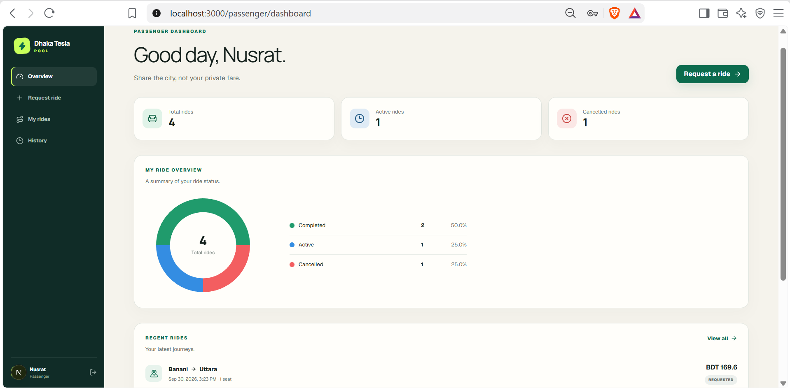
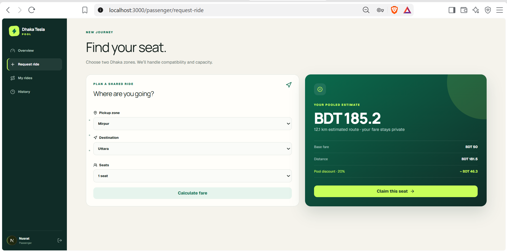
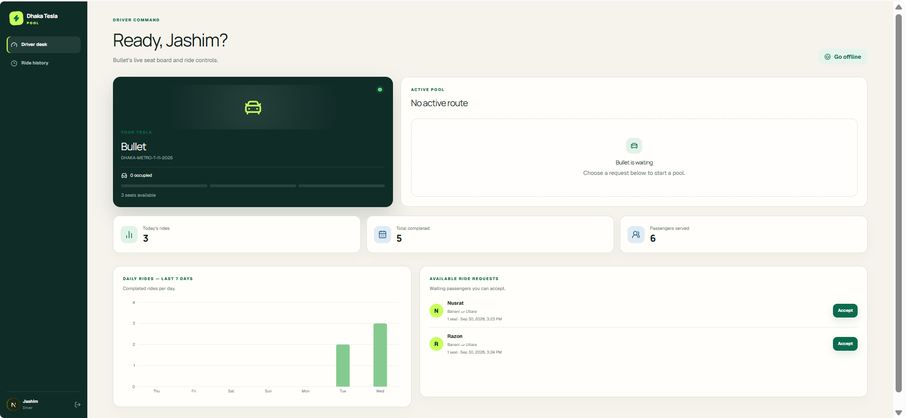
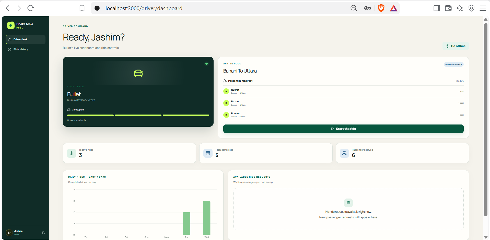
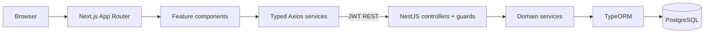

# Dhaka Tesla Pool

> Share a seat. Split the fare. Survive Dhaka traffic.

## Project Summary

Dhaka Tesla Pool is a production-minded local MVP that groups compatible passenger requests into one capacity-limited Tesla ride. It demonstrates modular full-stack design, strict authorization, auditable ride state, private passenger fares, and safe concurrent seat allocation without adding infrastructure that the MVP does not need.

## Problem Statement

Dhaka commuters often travel through the same corridors but cannot reliably share a vehicle without ambiguity around route compatibility, price privacy, available seats, or ride state. This application makes those rules explicit and enforceable.

## Core Users

- **Passenger:** estimates a fare, requests seats, sees personal status/fare, cancels before arrival, pays, and reviews history.
- **Driver:** controls an assigned Tesla, chooses waiting requests, reviews the passenger manifest, and advances an owned pool through its lifecycle.

## Demo Scenario

Jashim takes **Bullet** (capacity 3) online. Nusrat requests **Banani → Mohakhali** and Rafiq requests **Banani → Gulshan 1**. Both requests remain available until Jashim accepts them. Their destinations share the configured `BANANI_CENTRAL` corridor, so both can join one pool. Jashim marks arrival, starts, and completes the pool. Each passenger sees only their own fare. A simultaneous final-seat test proves occupied seats never exceed 3.

## Features

- JWT registration/login and current-user endpoint
- global authentication plus reusable role guards
- backend ownership checks for rides, pools, and driver actions
- online/offline Tesla management
- nine predefined Dhaka zones and deterministic corridors
- transparent fare estimates in integer poisha
- relational pools and explicit pool memberships
- pessimistic PostgreSQL row locking and capacity constraints
- centralized ride state machine and append-only status history
- simulated cash and TeslaPay records
- Swagger/OpenAPI, migration, idempotent story seed, Jest tests, and Docker Compose
- responsive passenger and driver experiences with validation, toasts, and loading/error/empty states

## Application Screenshots

These screens show the main passenger and driver workflows of the Dhaka Tesla Pool MVP.

### Passenger Dashboard

Nusrat's dashboard summarizes total, active, completed, and cancelled rides with a status chart, recent journeys, and a shortcut to request a ride.



### Request a Shared Ride

Passengers select a pickup zone, destination, and seat count before reviewing the base fare, distance charge, 20% pool discount, and estimated pooled fare.



### Driver Dashboard

Jashim's dashboard shows Bullet's seat availability, ride statistics, a seven-day completed-rides chart, and waiting requests that he can choose to accept.



### Shared Tesla Pool

The active-pool view shows three passengers sharing Bullet's three seats, with zero seats remaining. The manifest, `DRIVER_ARRIVED` status, and next driver action are visible; passenger fares remain private.



## Passenger Features

Passengers can register, sign in, estimate and request a ride, see matching/active/completed states and their own sanitized Tesla/pool association, cancel through `ACCEPTED`, pay after completion, and view the status timeline. Passenger endpoints derive identity from the JWT and never accept a client-provided passenger ID.

## Driver Features

Jashim can take Bullet online/offline, see all waiting requests, manually accept compatible requests into one active pool, review its passenger/seat manifest, mark arrival, start, complete, and review terminal pools. A driver can only control a pool assigned to their own account.

## Ride Lifecycle

```text
REQUESTED → MATCHED → ACCEPTED → DRIVER_ARRIVED → STARTED → COMPLETED
     └───────────────→ CANCELLED ←──────────────┘
```

Cancellation is allowed only from `REQUESTED`, `MATCHED`, or `ACCEPTED`. All transitions pass through one backend state policy and write a separate `RideStatusHistory` row.

## Ride Matching Logic

New requests stay `REQUESTED` until a driver accepts them. Acceptance requires an online vehicle, a still-requested ride, sufficient capacity, and the same pickup zone and configured corridor as the active pool. Compatible requests can join an `ACCEPTED` or `DRIVER_ARRIVED` pool, but not a `STARTED` pool. The routes Banani → Mohakhali and Banani → Gulshan 1 both map to `BANANI_CENTRAL`. Unconfigured pairs receive deterministic exact-route corridor keys.

## Pooling Logic

`Pool` stores aggregate capacity/state. `PoolMember` stores each ride, passenger, booked seats, and individual fare. Passenger pool responses expose aggregate membership information plus only the caller's membership; the driver manifest intentionally omits individual fares.

## Capacity & Concurrency Handling

Acceptance occurs inside one PostgreSQL transaction. The requested ride, driver's vehicle, and any active pool are locked with `pessimistic_write`; membership seats are recalculated, capacity is rechecked, membership is inserted, occupied seats and ride state are updated, history is written, then the transaction commits. The vehicle lock serializes simultaneous accepts for the same Tesla. Database checks also enforce `0 <= occupiedSeats <= capacity`.

This is sufficient for a single PostgreSQL consistency boundary. At larger scale, matching would be partitioned geographically and use idempotent commands, while PostgreSQL would remain authoritative for seat assignment.

## Fare Calculation

```text
base fare        = BDT 50 per seat
distance charge  = BDT 15 × zone distance × seats
pool discount    = 20% of pre-discount fare
pooled fare      = pre-discount fare − discount
```

Money is stored as integer poisha, avoiding binary floating-point currency errors. Nusrat's 2.2 km Banani → Mohakhali estimate is `5,000 + 3,300 − 1,660 = 6,640` poisha (BDT 66.40).

## Payment Model

`CASH` and `TESLA_PAY` are simulated. Payment is permitted only for an owned completed ride, one record is allowed per ride, and TeslaPay generates a local transaction reference. No real funds or gateway are involved.

## Architecture



See [architecture details](docs/architecture.md), [final requirements](docs/requirements.md), and [assumptions](docs/assumptions.md).

## ER Diagram

The complete Mermaid ERD and cardinalities are in [docs/erd.md](docs/erd.md).

## Technology Stack

- Frontend: Next.js App Router, React, TypeScript, Tailwind CSS, Axios, React Hook Form, Zod, Sonner, Lucide
- Backend: NestJS, TypeORM, PostgreSQL, Passport JWT, bcrypt, class-validator, Swagger
- Testing/infrastructure: Jest, Docker, Docker Compose

## Technology Decisions & Alternatives

**PostgreSQL** provides relations, foreign keys, checks, transactions, and row locking. MySQL could support the same broad model; SQLite would simplify a single-user demo but is a poor fit for demonstrating concurrent allocation.

**NestJS** provides modules, dependency injection, guards, validation, Swagger, and test utilities. Express or Fastify alone would be lighter but require more project conventions to be designed manually.

**Next.js** provides structured App Router pages and production builds while preserving React's component ecosystem. A Vite SPA would be simpler, but would give up the requested routing convention and future rendering flexibility.

**TypeORM** matches the requested stack and keeps entities, repositories, transactions, and migrations cohesive. Prisma is a reasonable alternative for a schema-first team.

**Authentication:** Passport JWT with bcrypt-hashed passwords and backend role/ownership guards keeps the two-role REST API stateless and private. Server sessions with secure cookies are a realistic alternative; switch if browser session revocation or first-party cookie controls become a product requirement.

**Styling:** Tailwind CSS with the project's existing CSS variables and component classes keeps the small passenger/driver interface consistent without another UI framework. CSS Modules are an alternative; switch if the custom component set grows enough that file-scoped styles are easier to maintain.

**Testing:** Jest unit tests and Supertest HTTP tests cover fare, state, capacity, authorization, and the real PostgreSQL acceptance race. Vitest and Playwright are alternatives for faster module tests and browser journeys; add/switch when the UI workflow surface or CI capacity warrants automated browser coverage.

**Hosting:** The current approach is local or self-hosted Docker Compose for the Next.js frontend, NestJS API, and PostgreSQL. A free managed frontend plus compatible free API/database hosts would reduce operations; switch when a suitable free tier can sustain the backend and database without losing required state or exceeding its limits. No public deployment is currently configured.

PostgreSQL row locking was selected over Redis distributed locks because one database is the MVP's consistency boundary and Redis would add failure modes without a current benefit.

## Project Structure

```text
.
├── dhaka-tesla-pool-frontend/   # Next.js application
├── dhaka-tesla-pool-backend/    # NestJS REST API
├── docs/                        # requirements, architecture, ERD, assumptions
├── docker-compose.yml
└── README.md
```

Exact frontend/backend trees are documented in [docs/architecture.md](docs/architecture.md).

## Frontend Architecture

App Router pages compose feature components. `contexts/` owns authentication state, `schemas/` owns Zod validation, `services/` owns API calls, `lib/api.ts` owns the Axios instance and bearer interceptor, and `types/` owns wire-level types. No page contains backend business rules.

## Backend Architecture

Controllers validate transport input and delegate. Domain services own matching, fare, lifecycle, payment, and ownership rules. Entities only describe persistence. Authentication and role checks are global; service-level checks protect resource ownership.

## Database Design

The core schema contains `users`, `vehicles`, `ride_requests`, `pools`, `pool_members`, `ride_status_history`, and `payments`. Foreign keys use deliberate delete behavior, queries have status/route indexes, and capacity/seat checks live in the database as defense in depth. Automatic synchronization is disabled.

## Authentication & Authorization

Passwords are hashed with bcrypt (cost 12). JWTs expire, DTOs are whitelisted and transformed, CORS uses `FRONTEND_URL`, secrets come from environment variables, and private endpoints require a valid token. Role checks never replace ownership checks.

## API Overview

The full method/path/role inventory is in [docs/requirements.md](docs/requirements.md). The API prefix is `/api`.

## Swagger

With the backend running, open [http://localhost:4000/api/docs](http://localhost:4000/api/docs).

## Environment Variables

Copy the provided examples:

```powershell
Copy-Item dhaka-tesla-pool-backend/.env.example dhaka-tesla-pool-backend/.env
Copy-Item dhaka-tesla-pool-frontend/.env.example dhaka-tesla-pool-frontend/.env.local
```

Use a strong, private `JWT_SECRET`. Never commit either generated environment file.

## Installation

Requirements for direct local development: Node.js 24+, npm, and PostgreSQL 17+.

```powershell
cd dhaka-tesla-pool-backend
npm ci
cd ../dhaka-tesla-pool-frontend
npm ci
```

## Running Locally

Create a PostgreSQL database named `dhaka_tesla_pool`, configure backend `.env`, then:

```powershell
cd dhaka-tesla-pool-backend
npm run migration:run
npm run seed
npm run start:dev
```

In a second terminal:

```powershell
cd dhaka-tesla-pool-frontend
npm run dev
```

Open [http://localhost:3000](http://localhost:3000).

## Docker Setup

Docker Desktop or Docker Engine with Compose v2 is required. From the repository root:

```powershell
Copy-Item .env.example .env
# Replace both placeholder values in the new root .env with private local values.
docker compose up --build
```

The root `.env` is ignored by Git and is used only for local Compose secrets. An existing PostgreSQL volume retains its original password, so reuse that password when configuring an existing volume. PostgreSQL must become healthy before the backend starts. The backend runs the compiled migration and idempotent seed before serving; the frontend waits for the API health check. Check `docker compose ps`, `http://localhost:4000/api`, and `http://localhost:3000` on a Docker-equipped machine. Stop with `docker compose down`. Add `-v` only when you deliberately want to remove the named development database volume.

## Database Migration

```powershell
cd dhaka-tesla-pool-backend
npm run migration:run
# npm run migration:revert   # only for an intentional rollback
```

Schema synchronization remains disabled in every environment.

## Seed Data

`npm run seed` is idempotent. It creates/updates the story cast and creates Bullet only when absent.

## Demo Credentials

All seeded users use development password `Pool123!`.

| Role | Name | Email |
|---|---|---|
| Driver | Jashim | `jashim@dhakapool.local` |
| Passenger | Nusrat | `nusrat@dhakapool.local` |
| Passenger | Rafiq | `rafiq@dhakapool.local` |
| Passenger | Shirin | `shirin@dhakapool.local` |

Vehicle: **Bullet**, registration `DHAKA-METRO-T-11-2026`, capacity 3, initially offline.

## Testing

```powershell
cd dhaka-tesla-pool-backend
npm test -- --runInBand
npm run lint
npm run build
# with the API running on port 4000:
npm run test:e2e -- --runInBand

cd ../dhaka-tesla-pool-frontend
npm run lint
npm run build
```

The Jest suite covers exact fares, discount math, invalid same-zone estimates, corridor compatibility, forward/backward state rules, cancellation cutoff, and final-seat capacity recalculation. The isolated HTTP acceptance suite verifies multiple waiting requests, manual selection, route and seat rejection, a simultaneous final-seat race, role denial, joining after arrival, cancellation rejection, and lifecycle completion.

The stateful driver acceptance suite runs only when `DRIVER_ACCEPT_TEST_API_URL` points to an API using a separate, migrated, seeded test database. It is skipped during the default e2e run to avoid changing the development database.

For that suite, create a dedicated PostgreSQL database (for example `dhaka_tesla_pool_test`), set `DATABASE_NAME` to it before running `npm run migration:run` and `npm run seed`, then start a separate backend on another port. In the test terminal, set `DRIVER_ACCEPT_TEST_API_URL` to that backend (for example `http://localhost:4001`) and run `npm run test:e2e -- --runInBand`. Never point it at the normal development database.

## Known Limitations

- Geography uses fixed zones/distances rather than GPS or navigation.
- Waiting requests require an online driver to accept them; there is no automatic assignment or request expiry.
- One vehicle per driver and one active pool per vehicle are MVP assumptions.
- The driver dashboard polls for updates every 10 seconds; there are no WebSocket push updates.
- Payment is simulation only.

## Future Improvements

- request expiry and driver notifications
- passenger/driver live updates
- configurable pricing/corridors
- richer integration tests in an isolated test database
- accessibility and browser test automation across more viewports

## Scaling Considerations

At one million passengers and 100,000 drivers: place stateless API replicas behind a load balancer; add targeted indexes and partition historical data; use read replicas for history; cache non-authoritative configuration; adopt PostGIS/geospatial search; partition matching by city cell/corridor; introduce event queues for notifications/analytics; use WebSockets for live state; add rate limits and idempotency keys; instrument traces, metrics, and structured logs; retry only idempotent operations; and monitor row-lock contention. These are future-scale options, not implemented MVP infrastructure.

## AI Usage

ChatGPT/coding assistance was used for architecture review, code review, test scenario generation, documentation refinement, and debugging support.

- Accepted suggestion: use a PostgreSQL transaction plus pessimistic row locking and post-lock seat recalculation.
- Rejected suggestion: add Redis-based distributed locking. It would unnecessarily increase infrastructure and operational complexity while PostgreSQL is the MVP's single consistency boundary.

## Deployment

Public deployment will be completed separately after the local MVP is finalized.

No Vercel, Render, Railway, Supabase hosting, AWS, or other public deployment configuration is included.

## Demo Video

Placeholder — record the final local demo after review.
