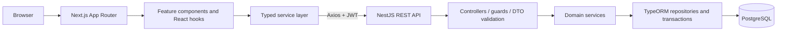

# Architecture



The frontend keeps rendering and interaction in feature components while API concerns live in typed services. The backend uses thin controllers, DTO validation, reusable authorization guards, and domain services. PostgreSQL is the consistency boundary for membership allocation.

## Final frontend structure

```text
dhaka-tesla-pool-frontend/
├── public/
├── src/
│   ├── app/
│   │   ├── driver/{dashboard,history}/
│   │   ├── passenger/{dashboard,request-ride,rides,history}/
│   │   ├── login/
│   │   ├── register/
│   │   ├── globals.css
│   │   ├── layout.tsx
│   │   └── page.tsx
│   ├── components/{app-shell,empty-state,loading-state}/
│   ├── contexts/auth-context.tsx
│   ├── features/
│   │   ├── auth/components/
│   │   ├── driver/components/
│   │   ├── rides/components/
│   │   └── shared/components/
│   ├── hooks/use-protected-route.ts
│   ├── lib/{api,auth-storage,cn,format}/
│   ├── schemas/{auth,ride}.schema.ts
│   ├── services/{auth,history,payment,pool,ride,vehicle}.service.ts
│   └── types/index.ts
├── .env.example
├── Dockerfile
└── package.json
```

## Final backend structure

```text
dhaka-tesla-pool-backend/
├── src/
│   ├── auth/{decorators,dto,guards,strategies}/
│   ├── common/{enums,filters,state-machine}/
│   ├── database/{migrations,seeds}/
│   ├── fares/{dto}/
│   ├── payments/{dto,entities}/
│   ├── pool-members/entities/
│   ├── pools/{entities}/
│   ├── ride-history/entities/
│   ├── ride-requests/{dto,entities}/
│   ├── users/{entities}/
│   ├── vehicles/{entities}/
│   ├── app.module.ts
│   ├── data-source.ts
│   └── main.ts
├── test/
├── .env.example
├── Dockerfile
└── package.json
```

